<!-- generated by assets/build.py from content.yml; edit that instead -->

<picture><source media="(prefers-color-scheme: dark)" srcset="assets/header-dark.svg">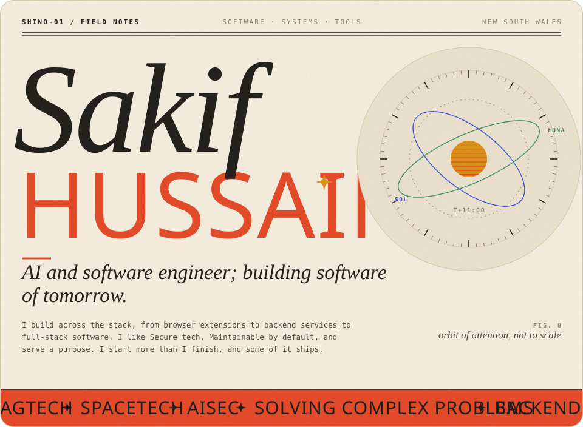</picture>

<picture><source media="(prefers-color-scheme: dark)" srcset="assets/activity-dark.svg"></picture>

<picture><source media="(prefers-color-scheme: dark)" srcset="assets/section-now-dark.svg">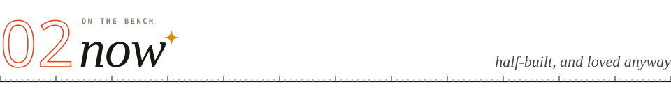</picture>

<a href="https://github.com/SHINO-01/rolestash-extension">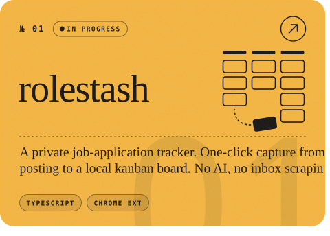</a><a href="https://github.com/SHINO-01/deltadrift">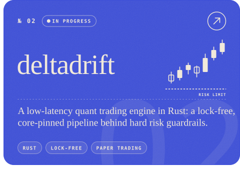</a> <a href="https://github.com/SHINO-01/orbitguard">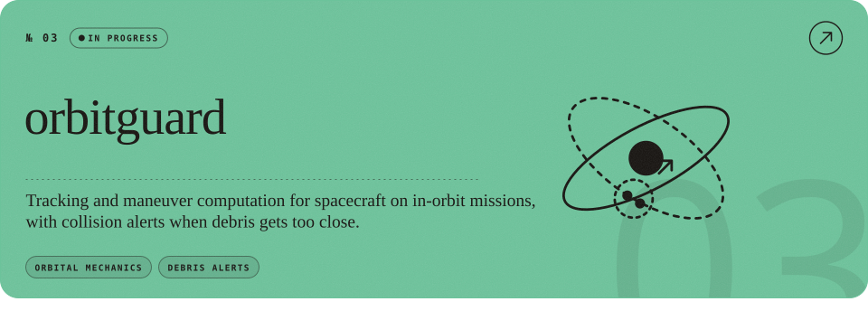</a>

<picture><source media="(prefers-color-scheme: dark)" srcset="assets/section-before-dark.svg">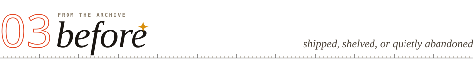</picture>

<a href="https://github.com/SHINO-01/EventureAI-W3-Hackathon">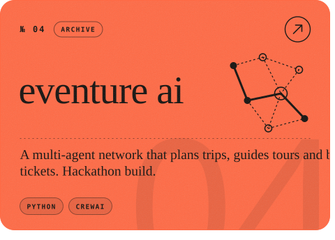</a><a href="https://github.com/SHINO-01/Three.js_TV_Room">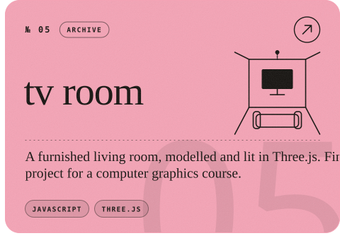</a> <a href="https://github.com/SHINO-01/Demon-Slayer-Game">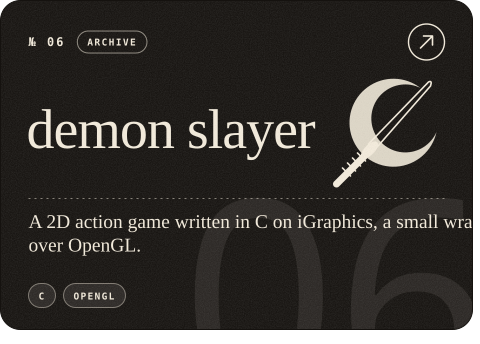</a><a href="https://github.com/SHINO-01/W3_Assignment_07">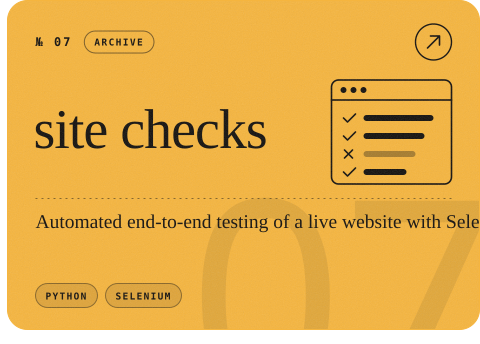</a>

<picture><source media="(prefers-color-scheme: dark)" srcset="assets/section-tools-dark.svg">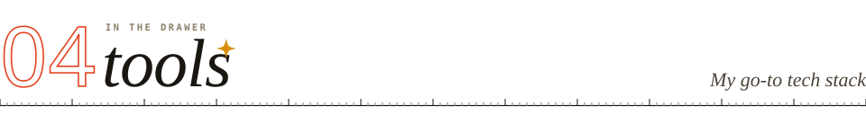</picture>

<picture><source media="(prefers-color-scheme: dark)" srcset="assets/tools-dark.svg">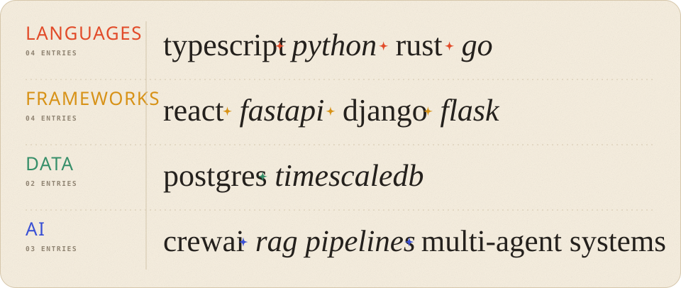</picture>

 

<picture><source media="(prefers-color-scheme: dark)" srcset="assets/footer-dark.svg">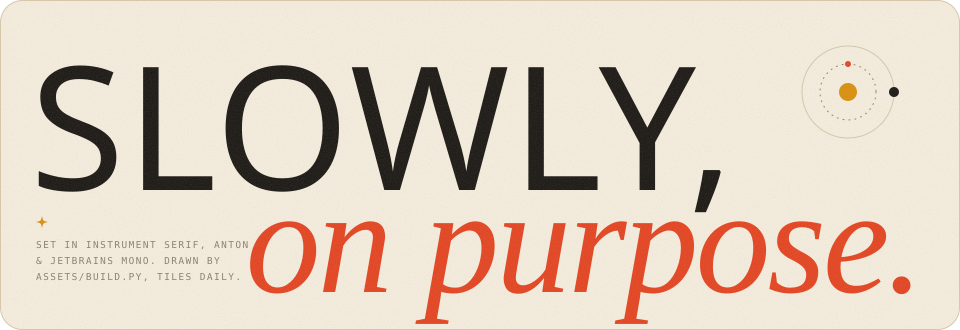</picture>
